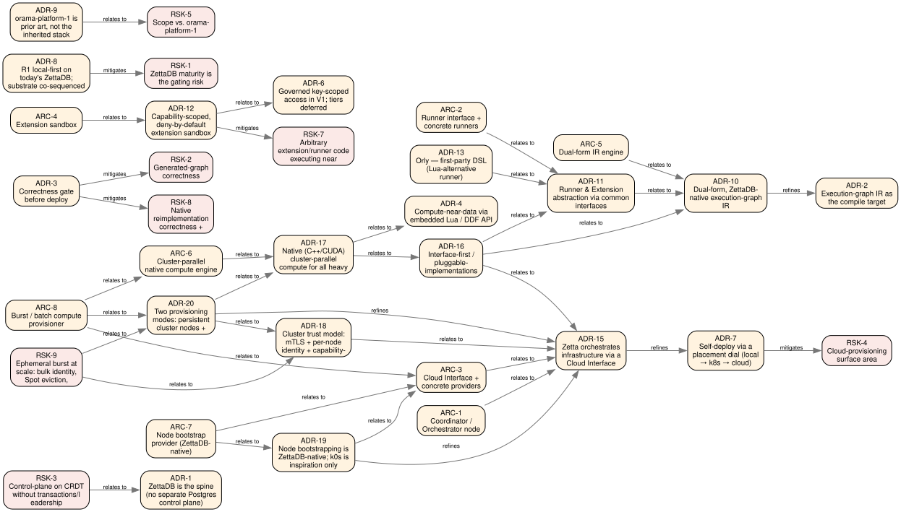
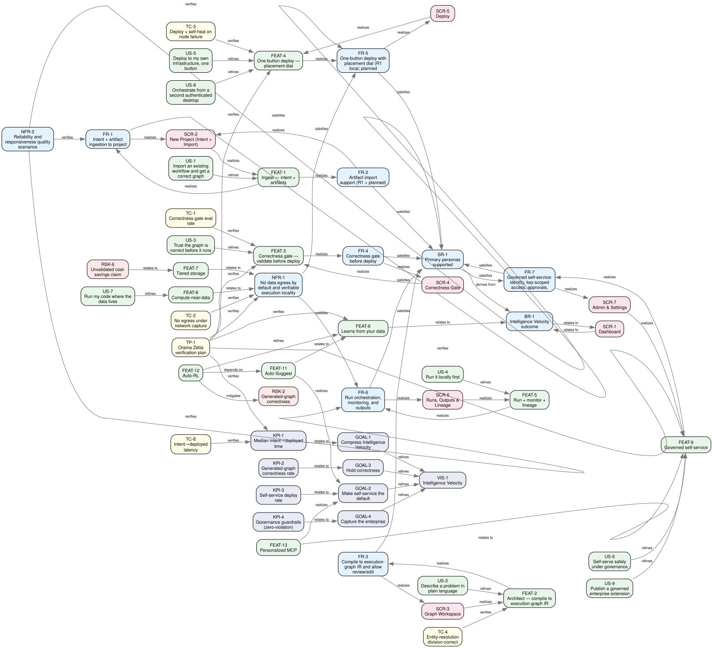
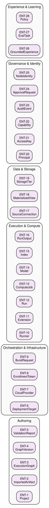

# Diagrams

Rendered from the blueprint with Graphviz. Sources (`.dot`) live beside the SVGs in [`docs/diagrams/`](https://github.com/oramasearch/zetta-docs/tree/main/docs/diagrams).

!!! note "Generated"
    Re-run `zetta-sync` to regenerate. Do not hand-edit.

## Architecture — decisions & elements

ADRs, architecture elements, quality scenarios, and the risks they mitigate (34 nodes, 36 edges).

[`architecture.dot`](diagrams/architecture.dot)

## Traceability — vision to verification

The spine: vision → goals → KPIs, business → stakeholder → functional requirements → features → screens/stories, plus the test cases and risks that touch them (52 nodes, 68 edges).

[`traceability.dot`](diagrams/traceability.dot)

## Domain context — bounded contexts & entities

The six bounded contexts and the domain entities inside them (28 entities).

[`domain-context.dot`](diagrams/domain-context.dot)

